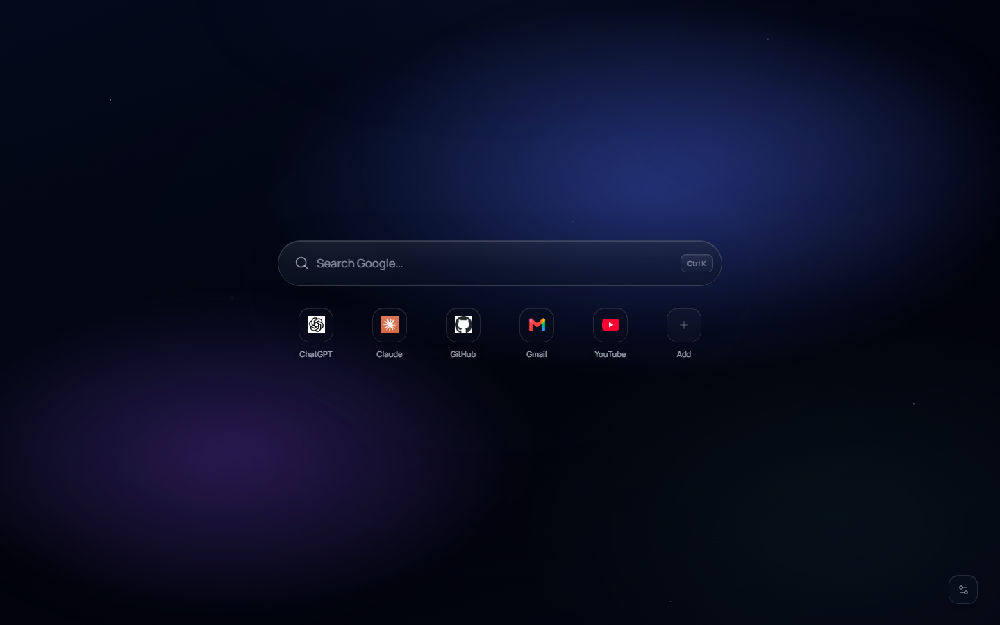
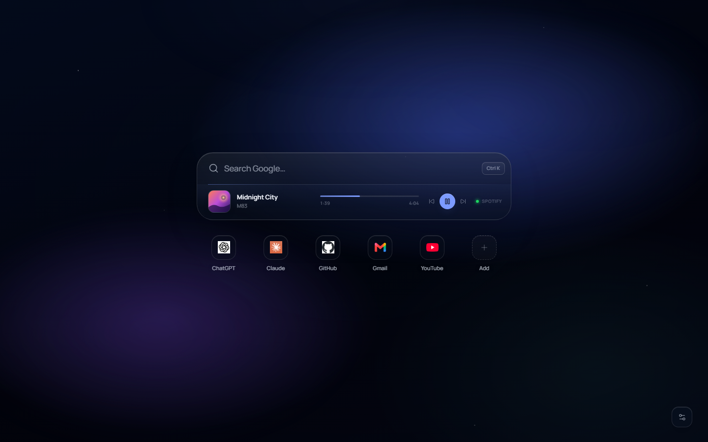
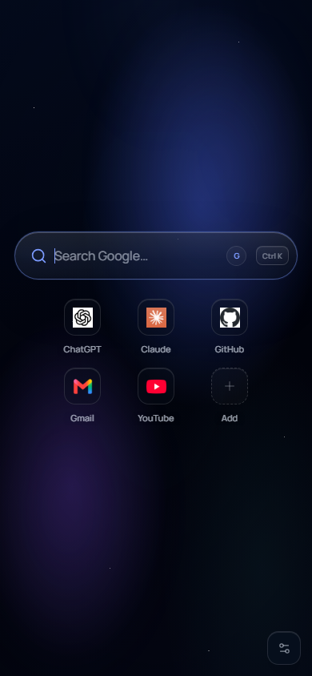

# Lumen

[](https://github.com/DragAditya/HomeExtension/actions/workflows/ci.yml)

A cinematic, privacy-first new tab for Chromium browsers. Lumen combines a quiet glass interface with fast search, shortcuts, weather, focus tools, notes, and an inline Spotify player.



## Features

- **Cinematic search** — Google, DuckDuckGo, and Bing, with keyboard-first search and suggestions.
- **Shortcuts** — bundled offline icons for the defaults, cached favicons for custom sites, and a monogram fallback so nothing flashes blank.
- **Inline Spotify** — album art, track and artist, progress, previous/play/next, and a live source indicator without leaving the new tab.
- **Weather** — current conditions and a short forecast through Open-Meteo; no geolocation permission is requested.
- **Focus and notes** — a quiet timer and a local scratchpad that stay out of the way.
- **Local-first wallpapers** — bundled scenes plus custom image and video wallpapers stored as Blobs in IndexedDB. Large videos are supported with no app-level size cap.
- **Performance-aware glass** — video wallpapers reduce backdrop blur, disable grain and parallax, preload, crossfade, and pause when the tab is hidden.
- **Private by default** — no analytics, no telemetry, no remote code, and no `<all_urls>` permission.



<p align="center">
  
</p>

## Install

### Load the prebuilt extension

The repository root is a ready-to-load unpacked extension.

1. Clone the repository.
2. Open `chrome://extensions`.
3. Enable **Developer mode**.
4. Choose **Load unpacked** and select the repository folder.
5. Open a new tab.

Chromium 120 or newer is required.

### Build from source

```bash
npm ci
npm run build
```

`npm run build` writes the production extension to `dist/`.

To copy the finished build over the repository root so it can be loaded as an unpacked extension:

```bash
npm run deploy
```

### Development

```bash
npm ci
npm run dev
```

The Vite development server runs the same React app in a normal browser tab. Spotify sign-in requires the installed extension because it uses `chrome.identity`.

## Spotify setup

Lumen uses Spotify's PKCE flow and does not ship a client secret.

1. Create an app in the [Spotify Developer Dashboard](https://developer.spotify.com/dashboard).
2. Add the redirect URI shown in **Settings → Integrations** inside Lumen. It uses the
   `https://<extension-id>.chromiumapp.org/` callback generated by `chrome.identity`.
3. Paste your Spotify client ID into Lumen and connect.

Access and refresh tokens stay in local extension storage. Lumen is not affiliated with Spotify.

## Privacy

- Settings, notes, shortcut metadata, and icon caches are stored locally in `localStorage`.
- Custom wallpapers and Spotify tokens are stored locally in the browser.
- Network requests go only to the configured search, weather, favicon, and Spotify endpoints.
- There is no analytics, tracking, advertising, or remote script loading.
- Location-based weather is resolved from a city search; the extension does not request geolocation.

## Permissions

| Permission | Why it is needed |
| --- | --- |
| `storage` | Save settings, notes, shortcuts, and local preferences. |
| `unlimitedStorage` | Allow large user-provided video wallpapers in IndexedDB. |
| `identity` | Open Spotify's OAuth flow in the installed extension. |

Host permissions cover Spotify, Open-Meteo, search suggestions, and favicon providers only.

## Tech stack

React 19 · TypeScript · Vite · Zustand · IndexedDB · Manifest V3

## Scripts

| Command | Description |
| --- | --- |
| `npm run dev` | Start the Vite development server. |
| `npm run build` | Type-check and build `dist/`. |
| `npm run deploy` | Build and copy `dist/` to the extension root. |
| `npm run typecheck` | Run TypeScript without emitting files. |
| `npm test` | Run the Vitest suite. |
| `npm run icons` | Regenerate the extension and shortcut icons. |

## Project layout

```text
src/
  app/          Application shell and providers
  components/   Shared UI primitives
  features/     Search, shortcuts, Spotify, weather, focus, notes, settings, wallpaper
  lib/          Storage, Spotify, favicon, wallpaper, theme, and utility logic
  styles/       Layered CSS for the glass interface and responsive states
  store/        Zustand stores
public/         Manifest, extension icons, and bundled shortcut icons
scripts/        Source preparation, icon generation, and deploy helpers
tests/          Unit tests
```

## Contributing

Small, focused pull requests are welcome. Run `npm run typecheck`, `npm test`, and `npm run build` before opening one. For security issues, please use GitHub's private security advisory flow instead of a public issue.

## License

MIT © 2026 Aditya
